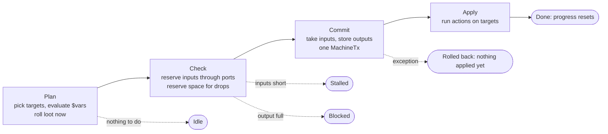

# Machine module: data-only machines

> **Status: proposal, not built.** Builds on the [rebuild plan](rebuild-plan.md) and
> [recipes](recipes.md): `MachineTx`, slot groups, the three ingredient kinds and the per-loader
> adapters all stay, and everything here sits on top of them. JSON keys are proposed names;
> `//` lines in JSON blocks are annotations, not part of the file.

The aim is a mod like Industrial Foregoing written as JSON. A machine is one file. Each of its
operations picks things in the world to work on, works out what it will take and give, and then
does all of it at once. Recipes stop naming slots and start naming **ports**, so the same recipe
works whether wheat comes from the machine's own slots, a chest above it, or a teammate's hotbar.

## Three questions, one operation

Every machine behaviour answers three questions: where does stuff come from and go to, what in
the world is being worked on, and what happens to it. Keep those apart and an operation is just
the glue.

```mermaid
flowchart LR
  subgraph Ports["Ports: where stuff comes from and goes"]
    p1[Own slot groups]
    p2[Neighbors on each face]
    p3[Target's inventory]
    p4[Items / XP on the ground]
    p5[World fluids]
    p6[Linked machines]
  end
  subgraph Op["Operation, every N ticks"]
    plan[Plan: pick targets, compute amounts, roll loot]
    check[Check: reserve inputs and output space]
    commit[Commit: take inputs, store outputs]
    apply[Apply: change the world]
    plan --> check --> commit --> apply
  end
  subgraph Targets["Targets in the area"]
    t1[Entities: EntityPredicate]
    t2[Blocks: BlockPredicate]
    t3[Players: team + opt-in]
    t4[Positions: grid, empty ground]
    t5[Items and XP on the ground]
  end
  subgraph Actions["Actions on each target"]
    a1[breed · shear · milk · kill]
    a2[harvest · place · bonemeal]
    a3[use_item_on · run_function]
    a4[set_var · sound · effect]
  end
  Targets -- select, filter --> plan
  Ports -- reserve --> check
  commit -- take, store --> Ports
  apply -- perform --> Actions
```



All four steps run inside one tick call. "Target's inventory" is how a player or villager becomes
a source: the port points at whatever the operation is currently working on.

| Word | Means | Lives in |
|---|---|---|
| Port | A name an operation consumes from or produces into, bound to an ordered list of sources | `ports` |
| Source | One concrete place: a slot group, a neighbor face, the target's hotbar, a tank | inside a port |
| Target | The thing an operation works on this run: an entity, block, player, position or item on the ground | `operation.target` |
| Action | A registered, two-step effect: check it can happen, then do it | `operation.act` |
| Operation | One repeating job: target + when + consume + act + produce + drops | `operations` |
| Variable | A synced, saved value the machine owns; actions write it, conditions and screens read it | `variables` |
| Modifier | A number that comes from installed upgrades: speed, range, looting | `modifiers` |

## Ports

A port is an ordered list of sources. The transaction walks them in order and may split one input
across several. Ports work both ways, so the same mechanism that takes food from a teammate can
top up their torches or take their cobblestone away.

```json
"ports": {
  "feed":   ["feed", { "neighbors": "up" }, { "target_inventory": "main", "keep": 16 }],
  "output": ["output", { "neighbors": "down" }],
  "hotbar": [{ "target_inventory": "hotbar" }]
}
```

Example: an operation consumes `feed: 12 × wheat`.

| Order | Source | Holds | Takes |
|---|---|---|---|
| 1 | Own slots `feed` | 4 | 4 |
| 2 | Chest above (`neighbors: up`) | 30 | 8 |
| 3 | Teammate in range, `keep: 16` | 40 | 0, not reached |

If all three together came up short, nothing would be taken from any of them and the operation
would stall.

| Source | Way | How it's reached | Rules |
|---|---|---|---|
| Slot group (`"feed"`) | in / out | The machine's own storage | Filters apply; roles don't, as for any internal access |
| `neighbors` | in / out | Capability per face (NeoForge), `BlockApiLookup` (Fabric) | The neighbor's own rules apply. `"*"` means all faces, in a fixed order |
| `target_inventory` | in / out | Player inventory wrapper; entity capability (NeoForge) or `EntityApiLookup` (Fabric); vanilla `InventoryCarrier` for villagers | Slots: `main`, `hotbar`, `armor`, `offhand`. Optional `keep`. Players only through a consenting player target |
| `ground` | in | Item entities inside the area | Same items a `pick_up` action would see |
| `xp` | in / out | XP orbs in the area, or the target player's levels | Conversion rate set on the port, e.g. 20 mB per point |
| `world_fluid` | in / out | Source blocks in the area | Whole buckets only (1000 mB). Placing respects claims |
| `linked` | in / out | Positions stored on a link-card item in a slot | Same dimension, loaded chunks only. The linked machine's own ports are not followed |

## Targets

The area belongs to the machine: a box or sphere anchored in front of it, on top of it, or
centered. A range upgrade grows it. Blocks are found by a cursor that walks the area a few
positions per tick, so a large farm costs the same per tick as a small one. Entities are found
with one box query per run. Positions in unloaded chunks are skipped, never loaded.

```json
"area": {
  "shape": "box", "size": [9, 1, 9], "anchor": "front",
  "grow": { "upgrade": "example:range", "per_level": [1, 0, 1], "max_level": 2 }
},
"operations": {
  "harvest": {
    "target": {
      "blocks": { "blocks": "#minecraft:crops", "state": { "age": "7" } },
      "pick": "cursor", "scan_per_tick": 16,
      "limit": 1
    }
  }
}
```

The `blocks` object is vanilla's `BlockPredicate`, the same format advancements use.

| Key | Values | Use it for |
|---|---|---|
| `pick` | `nearest`, `random`, `round_robin`, `all`, `first` | Entities and players. `round_robin` spreads milking across a herd |
| | `cursor` | Blocks and positions; walks the area across ticks (a snake, row by row) |
| | `pair_same_type` | Breeding: two adults of one type that can both breed |
| `limit` | number | Targets per run. Costs marked `"per": "target"` scale with it |
| `filter` | list of conditions | Checks the predicate can't express, like `mmdlib:can_breed` |
| `cooldown_per_target` | ticks | Kept in the machine's memory by UUID or position, not on the entity. Pruned when targets leave |
| `expand` | `connected`, `also`, `max`, `order` | Turns one hit into a group: a whole tree, a vein, a sugar-cane column |

## Plan, check, commit, apply

You can roll back an inventory but not a sheared sheep. So everything that can fail happens
before anything is changed, and the world is touched last. Loot is rolled during the plan, so the
check knows the exact drops instead of guessing.



Plan to Apply happens inside one tick call of one machine, so nothing else changes the world in
between. States are per operation: a ranch can be Blocked on milk while shearing keeps running.
When the loader only reveals drops at apply time (NeoForge 1.21.1's `IShearable`,
`use_item_on`), the plan reserves the most that action can produce instead.

## Actions

An action is a registered type with a codec, a check and an apply, like vanilla's loot functions.
Mods add their own the same way. World changes go through a stand-in player that represents the
machine's owner, so claim and protection mods can refuse them through the loader's normal break,
place and attack events.

| Action | Target | Check (plan) | Apply | Drops |
|---|---|---|---|---|
| `mmdlib:breed` | 2 animals | adult, not in love, can breed | set in love, owner as cause | none |
| `mmdlib:shear` | entity | `readyForShearing()` | mark sheared, play sound | shearing loot, rolled in plan |
| `mmdlib:harvest` | block | matches, owner may break it | remove without drops, break particles | `Block.getDrops` with the tool, rolled in plan |
| `mmdlib:place` | position | replaceable, block can survive there | place as owner | none |
| `mmdlib:kill` | entity | never a player; not protected by filters | damage as owner with weapon and looting | entity loot, captured by the loader adapter |
| `mmdlib:pick_up` | item or XP on ground | still there | remove the entity | the stack or XP |
| `mmdlib:use_item_on` | entity or block | item on the mod's allow-list | stand-in player right-clicks with the item | whatever it leaves behind; space reserved for the worst case |
| `mmdlib:apply_effect` | entity or player | effect not already stronger | add `MobEffectInstance` | none |
| `mmdlib:set_var`, `add_var` | none | always | write a machine variable | none |
| `mmdlib:play_sound`, `particles` | any | always | client feedback | none |
| `mmdlib:run_function` | any | function exists | runs a datapack `.mcfunction` at the target | none |

`use_item_on` alone covers milking, bonemealing, tilling, sowing, dyeing and bucketing fish, but
it is also where duplication bugs live. Each mod lists the items it allows; nothing is allowed by
default.

## Context variables and expressions

A feeder needs *this animal's* food, a mob crusher's cost should grow with the mob's health, and
a restocker takes only what's missing. Any number or item in an operation may be a `$` reference
or a short expression. The grammar is deliberately small: numbers, variables, `+ - * /`,
comparisons, `and` / `or` / `not`. No loops, no strings, no calls.

| Reference | Value | Example |
|---|---|---|
| `$target` | The current target. Fields: `.max_health`, `.health`, `.type`, `.pos` | `"200 + 2 * $target.max_health"` |
| `$targets.count` | How many targets this run selected | a head count |
| `$consumed.<port>` | The stack or fluid actually taken, with `.count` | place the sapling that was taken |
| `$next.<port>` | What would be taken next, without taking it | check the next sapling can be placed |
| `$rule` | The current ghost slot in a `for_each`: `.item`, `.count` | "keep 32 torches in the hotbar" |
| `$<variable>` | A machine variable | `"$adults < $max_adults"` |
| `$<modifier>` | A modifier from upgrades | `"looting": "$looting"` |
| `let` | Named values computed in the plan, in order | `"missing": { "type": "mmdlib:missing", ... }` |

Context-dependent ingredients are ordinary ingredient types that read the target:
`mmdlib:target_food` matches whatever the current animal eats, and drops come from the target's
loot table. They plug into `ItemPart` as the ingredient, so `AmountMatch` and ports work unchanged.

## The machine definition

MMDLib's existing block-entity definitions already create the block. The new file adds structure
and behaviour. Storage sizes and variables have to exist when the game registers capabilities and
save data, so they load at startup. Everything about behaviour is datapack content and reloads
with `/reload`.

| Section | Produces | Loads from |
|---|---|---|
| `groups` | Item, fluid and energy storages, exposed as capabilities | startup |
| `variables` | Synced, saved values for screens and conditions | startup |
| `area` | The box or sphere the machine reaches, grown by upgrades | datapack |
| `modifiers` | Speed, cost, range and looting from upgrade items | datapack |
| `ports` | The ordered sources behind each port | datapack |
| `operations` | The work list: target, when, consume, act, produce | datapack |
| `screen` | The XML screen, bound to `$variables` and `#getters` | resource pack |

[Machine UI](machine-ui.md#three-ways-to-change-a-machine-one-set-of-stats) folds `modifiers`
into named stats fed by upgrades, engine parts and face cards, and adds `faces` and `internals`
sections; the examples below still use `modifiers` and fixed `neighbors` for brevity.

The startup part lives with the block-entity definition; the datapack part under
`data/<ns>/mmdlib/machine/`. A reload that changes the datapack part restarts each operation's
progress but never touches stored items.

Screens gain values bound to machine variables with `$`, next to today's `#getter` bindings, plus
built-in handlers to edit them. Element names are today's:

```xml
<meter value="$adults" max="$max_adults"/>
<progress value="$op.shear.progress" max="$op.shear.every"/>
<checkbox text="screen.example.breeding" value="$breeding" on-click="mmdlib:toggle_var" var="breeding"/>
<button text="screen.example.show_area" on-click="mmdlib:toggle_area"/>
```

## Worked examples

Each is a complete file. Tags such as `#example:ranch_animals` are the pack's own.

### Ranch: feed, breed, shear, milk

Four operations share one area. A head count keeps breeding below a limit the player sets on the
screen. Shearing wears the shears in the tool slot. Milking takes empty buckets and spreads itself
across the herd.

```json
{
  "groups": {
    "feed":     { "items": 9,  "role": "input" },
    "tools":    { "items": 1,  "role": "input", "filter": "#c:tools/shear" },
    "buckets":  { "items": 4,  "role": "input", "filter": "minecraft:bucket" },
    "output":   { "items": 12, "role": "output" },
    "energy":   { "energy": 100000, "max_insert": 2000 },
    "upgrades": { "items": 3, "filter": "#example:upgrades" }
  },
  "variables": {
    "adults":     { "int": 0 },
    "max_adults": { "int": 24, "min": 2, "max": 64, "screen": "edit" },
    "breeding":   { "bool": true, "screen": "edit" }
  },
  // everything below is datapack content and reloads
  "area": {
    "shape": "box", "size": [9, 3, 9], "anchor": "front",
    "grow": { "upgrade": "example:range", "per_level": [2, 0, 2], "max_level": 2 }
  },
  "modifiers": {
    "speed": { "upgrade": "example:speed", "default": 1,
               "value": { "type": "minecraft:linear", "base": 1.5, "per_level_above_first": 0.5 } }
  },
  "ports": {
    "feed":    ["feed", { "neighbors": "up" }],
    "buckets": ["buckets", { "neighbors": "up" }],
    "output":  ["output", { "neighbors": "down" }]
  },
  "operations": {
    "count": {
      "every": 100,
      "target": { "entities": { "type": "#example:ranch_animals", "flags": { "is_baby": false } },
                  "pick": "all" },
      "act": [{ "type": "mmdlib:set_var", "var": "adults", "to": "$targets.count" }]
    },
    "feed": {
      "every": "40 / $speed",
      "when": ["$breeding", "$adults < $max_adults"],
      "target": {
        "entities": { "type": "#example:ranch_animals", "flags": { "is_baby": false } },
        "filter": [{ "type": "mmdlib:can_breed" }],
        "pick": "pair_same_type"
      },
      "consume": {
        "feed":   { "ingredient": { "type": "mmdlib:target_food" }, "count": 1, "per": "target" },
        "energy": { "amount": 300, "per": "target" }
      },
      "act": [{ "type": "mmdlib:breed" }]
    },
    "shear": {
      "every": "20 / $speed",
      "target": {
        "entities": { "type": "#example:shearable" },
        "filter": [{ "type": "mmdlib:ready_for_shearing" }],
        "pick": "nearest", "limit": 1
      },
      "consume": { "tools": { "durability": 1 }, "energy": 150 },
      "act": [{ "type": "mmdlib:shear", "tool": "tools" }],
      "drops": { "to": "output", "when_full": "stall" }
    },
    "milk": {
      "every": 60,
      "target": {
        "entities": { "type": "#example:milkable", "flags": { "is_baby": false } },
        "pick": "round_robin", "limit": 1, "cooldown_per_target": 1200
      },
      "consume": { "buckets": { "item": "minecraft:bucket" }, "energy": 100 },
      "produce": { "output": { "item": "minecraft:milk_bucket" } },
      "act": [{ "type": "mmdlib:play_sound", "sound": "minecraft:entity.cow.milk" }]
    }
  }
}
```

One run, tick by tick:

| Tick | Operation | What happens | Ends |
|---|---|---|---|
| 0 | `count` | 18 adult animals in the area, so `adults` becomes 18 | Done |
| 20 | `shear` | Nearest ready sheep. Plan rolls its loot: 2 white wool. Check finds room in `output`. Commit takes 1 durability from the shears (238 → 237) and 150 FE, stores the wool. Apply marks the sheep sheared | Done |
| 40 | `feed` | 18 < 24 and breeding is on. Picks two cows that can breed. `target_food` resolves to wheat, 1 per cow. Port `feed` has 1 wheat in its own slots and takes the other from the chest above. 600 FE. Apply sets both cows in love | Done |
| 40 | `shear` | No sheep is ready. Only this operation idles | Idle |
| 60 | `milk` | Next cow in the rotation. A bucket is available, but `output` is full and the chest below is full too | Blocked |
| 100 | `count` | The calf born at tick 41 is a baby, so `adults` stays 18 | Done |

### Arboretum: whole-tree farm

One hit on a log becomes the whole tree. Saplings that fall out are routed back into the sapling
slots before anything goes to the output, so the farm feeds itself. An axe in the tool slot is
optional: with one, its enchantments apply and it wears down; without one, it chops bare-handed.

What one hit becomes: the cursor finds the lowest log; `expand` collects the connected logs (up
to 256) plus the leaves touching them; logs break top-down so nothing is left floating if the
farm stops halfway; leaves follow, one per run; `plant` fills the hole later. The expanded group
stays as the target across runs, and each run breaks one block of it, so a big tree costs the
same per tick as a small one.

```json
{
  "groups": {
    "saplings":   { "items": 6,  "role": "input", "filter": "#minecraft:saplings" },
    "fertilizer": { "items": 3,  "role": "input", "filter": "minecraft:bone_meal" },
    "axe":        { "items": 1,  "role": "input", "filter": "#minecraft:axes" },
    "output":     { "items": 18, "role": "output" },
    "energy":     { "energy": 200000, "max_insert": 4000 }
  },
  "variables": { "logs_cut": { "long": 0 } },
  "area": { "shape": "box", "size": [11, 14, 11], "anchor": "front" },
  "ports": {
    "saplings": ["saplings", { "neighbors": "up" }],
    "output":   ["output", { "neighbors": "down" }]
  },
  "operations": {
    "chop": {
      "every": 4,
      "target": {
        "blocks": { "blocks": "#minecraft:logs" },
        "pick": "cursor", "scan_per_tick": 32,
        "expand": { "connected": "#minecraft:logs", "also": "#minecraft:leaves",
                    "max": 256, "order": "top_down" },
        "limit": 1
      },
      "consume": { "axe": { "durability": 1, "optional": true }, "energy": 400 },
      "act": [
        { "type": "mmdlib:harvest", "tool": "axe" },
        { "type": "mmdlib:add_var", "var": "logs_cut", "by": 1,
          "only_if": { "blocks": "#minecraft:logs" } }
      ],
      "drops": {
        "route": [
          { "match": "#minecraft:saplings", "to": "saplings" },
          { "to": "output" }
        ],
        "when_full": "stall"
      }
    },
    "plant": {
      "every": 40,
      "target": {
        "positions": { "grid": 3, "y": "ground" },
        "filter": [{ "type": "mmdlib:can_place", "item": "$next.saplings" }],
        "pick": "cursor", "limit": 1
      },
      "consume": { "saplings": { "count": 1 }, "energy": 50 },
      "act": [{ "type": "mmdlib:place", "item": "$consumed.saplings" }]
    },
    "grow": {
      "every": 30,
      "target": { "blocks": { "blocks": "#minecraft:saplings" }, "pick": "random", "limit": 1 },
      "consume": { "fertilizer": { "count": 1 }, "energy": 80 },
      "act": [{ "type": "mmdlib:use_item_on", "item": "$consumed.fertilizer" }]
    },
    "sweep": {
      "every": 20,
      "target": { "ground": { "items": ["#minecraft:saplings", "minecraft:apple", "minecraft:stick"] },
                  "pick": "all" },
      "act": [{ "type": "mmdlib:pick_up" }],
      "drops": {
        "route": [{ "match": "#minecraft:saplings", "to": "saplings" }, { "to": "output" }],
        "when_full": "stall"
      }
    }
  }
}
```

A drop route may put items into an input group such as `saplings`. That is internal access, so
the group's role doesn't stop it; its filter still does.

### Quartermaster: player restock and collect

A shared base chest that looks after nearby teammates. Ghost slots on the screen say what to keep
in the hotbar and how many (32 torches, 16 steak). A second row of ghost slots lists junk to take
away (cobblestone, dirt). Only teammates who switched it on in the screen are touched.

```json
{
  "groups": {
    "stock":  { "items": 27 },
    "wanted": { "ghost": 9 },  // item + amount to keep in the hotbar
    "junk":   { "ghost": 9 },  // items to take out of the main inventory
    "energy": { "energy": 50000, "max_insert": 1000 }
  },
  "area": { "shape": "sphere", "radius": 12, "anchor": "center" },
  "ports": {
    "stock":  ["stock", { "neighbors": "*" }],
    "hotbar": [{ "target_inventory": "hotbar" }],
    "pack":   [{ "target_inventory": "main" }]
  },
  "operations": {
    "restock": {
      "every": 20,
      "target": { "players": { "who": "team", "consent": "toggle" }, "pick": "all" },
      "for_each": { "ghost": "wanted", "as": "rule" },
      "let": {
        "missing": { "type": "mmdlib:missing", "port": "hotbar",
                     "item": "$rule.item", "keep": "$rule.count" }
      },
      "when": ["$missing > 0"],
      "consume": {
        "stock":  { "item": "$rule.item", "count": "$missing", "up_to": true },
        "energy": "10 * $consumed.stock.count"
      },
      "produce": { "hotbar": "$consumed.stock" }
    },
    "collect": {
      "every": 40,
      "target": { "players": { "who": "team", "consent": "toggle" }, "pick": "all" },
      "for_each": { "ghost": "junk", "as": "rule" },
      "consume": {
        "pack":   { "item": "$rule.item", "count": 64, "up_to": true },
        "energy": 40
      },
      "produce": { "stock": "$consumed.pack" },
      "when_full": "stall"
    }
  }
}
```

- **Why `up_to`.** Without it, a restock of 30 torches with 12 in stock would stall. With it, the
  run takes the 12 and charges energy for 12, because energy is evaluated after the item it
  refers to.
- **Why the target picks players, not the port.** Who may be touched is decided once, by the
  target selector, with `who` and `consent`. Ports only say which part of the current target's
  inventory to use, so a port can never reach a player the target step didn't approve.

### Mob crusher: kill, loot, liquid XP

Kills mobs in front of it as if its owner did, so drops include player-only loot. A looting
upgrade raises the looting level. XP goes into a tank as the pack's own liquid XP. Tamed animals
are always spared; named mobs are spared while a screen switch is on. Energy cost grows with the
mob's maximum health.

```json
{
  "groups": {
    "output":   { "items": 18, "role": "output" },
    "xp":       { "fluid": 16000, "role": "output", "filter": "example:liquid_xp" },
    "weapon":   { "items": 1, "role": "input", "filter": "#minecraft:swords" },
    "energy":   { "energy": 500000, "max_insert": 10000 },
    "upgrades": { "items": 2, "filter": "#example:upgrades" }
  },
  "variables": { "spare_named": { "bool": true, "screen": "edit" } },
  "area": { "shape": "box", "size": [5, 3, 5], "anchor": "front" },
  "modifiers": {
    "looting": { "upgrade": "example:looting", "default": 0,
                 "value": { "type": "minecraft:linear", "base": 1, "per_level_above_first": 1 } }
  },
  "ports": {
    "output": ["output", { "neighbors": "down" }],
    "xp":     ["xp", { "neighbors": "back" }]
  },
  "operations": {
    "crush": {
      "every": 20,
      "target": {
        "entities": { "type": "#example:crushable" },
        "filter": [
          { "type": "mmdlib:not", "of": { "type": "mmdlib:tamed" } },
          { "type": "mmdlib:not", "of": { "type": "mmdlib:named" }, "only_if": "$spare_named" }
        ],
        "pick": "all", "limit": 4
      },
      "consume": {
        "energy": { "amount": "200 + 2 * $target.max_health", "per": "target" },
        "weapon": { "durability": 1, "per": "target", "optional": true }
      },
      "act": [{ "type": "mmdlib:kill", "as": "owner", "weapon": "weapon", "looting": "$looting" }],
      "drops": { "to": "output", "when_full": "stall" },
      "xp":    { "to": "xp", "mb_per_point": 20 }
    }
  }
}
```

The `entities` selector never returns players, whatever the tag says. Players are only reachable
through the `players` selector with `who` and `consent`, and `mmdlib:kill` refuses them anyway.

## Vanilla already has most of the formats

Every block above that looks like vanilla JSON is vanilla JSON, read with vanilla's own codec.

| Need | Vanilla type | Where it appears |
|---|---|---|
| Entity filters | `EntityPredicate` | `target.entities` |
| Block filters, with state | `BlockPredicate` | `target.blocks` |
| Item matching | `Ingredient`, `ItemPredicate` | consume, ghost rules, drop routes |
| Weather, light, biome, dimension | `LocationPredicate`, `LootItemCondition` | `when` |
| Drops | Loot tables with `LootParams` (tool, attacker, looting) | `harvest`, `shear`, `kill` |
| Values that grow per upgrade level | `LevelBasedValue` | `modifiers` |
| Ready-made world effects | Enchantment effect types: `apply_mob_effect`, `damage_entity`, `ignite`, `replace_block`, `summon_entity`, `run_function` | `act`, if they can be called cleanly outside an enchantment |
| Existing recipes | `RecipeType`: smelting, blasting, smoking, stonecutting | `"recipes": { "type": "minecraft:smelting", "input": "in", "output": "out" }` |

## When JSON isn't enough

Sources, target selectors, actions, conditions, ingredient types and `let` functions are each a
registry of codecs, built the way vanilla builds loot functions. A mod that needs something new
registers one type and then uses it from JSON like the built-in ones. Roughly what
`mmdlib:shear` itself looks like:

```java
public record ShearAction(String tool) implements MachineAction {
  public static final MapCodec<ShearAction> CODEC =
      Codec.STRING.optionalFieldOf("tool", "").xmap(ShearAction::new, ShearAction::tool);

  @Override
  public boolean check(ActionContext ctx, Target target) {
    return target.entity() instanceof Shearable s && s.readyForShearing();
  }

  @Override
  public void plan(ActionContext ctx, Target target, Plan plan) {
    plan.drops(ctx.platform().rollShearLoot(target.entity(), ctx.toolStack(tool))); // exact drops, before anything changes
  }

  @Override
  public void apply(ActionContext ctx, Target target) {
    ctx.platform().markSheared(target.entity());
  }
}

// registered once, used from JSON as { "type": "example:shear" }
MachineRegistries.ACTIONS.register("shear", () -> ShearAction.CODEC);
```

The `platform()` calls are where loader differences go: NeoForge 1.21.1 has `IShearable`, 26.x
uses vanilla shearing loot tables. The action itself stays in the shared core. What stays real
code: multiblocks, custom rendering, complex AI, and machines like the laser drill whose
behaviour is a simulation rather than a sequence of actions.

## Rules the engine enforces, not the pack

- **Players opt in.** Players are reachable only through the `players` selector. `who` is
  `owner`, `team` or `anyone`; `consent` is `toggle` or `always`. A server config can force
  `toggle` for every machine.
- **Claims can say no.** Breaking, placing, attacking and using go through a stand-in player for
  the owner (NeoForge `FakePlayerFactory`, Fabric `FakePlayer`) and the loader's events, so claim
  mods refuse them like they would a real player.
- **No chunk loading.** Targets and sources in unloaded chunks are skipped. Linked machines must
  be loaded. A server config caps area volume and expand size.
- **Fixed cost per tick.** Cursors scan a set number of positions per tick. Entity queries run
  once per operation run. Expanded groups are worked one block per run.
- **No dupes by default.** `use_item_on` allows nothing until a mod lists items. Loot is rolled
  once, in the plan, from the level's random source.
- **Readable failures.** Every operation reports Idle, Stalled or Blocked with a reason key the
  screen can show ("output full", "no adult pairs").

## Cost

These phases follow phase 8 of the [rebuild plan](rebuild-plan.md#phases) and assume its core,
adapters and three builds exist.

| # | Work | Estimate |
|---|---|---|
| 9 | Ports with own groups and neighbors; expression grammar; `let` | about 1 week |
| 10 | Area, target selectors, cursor, `expand`, per-target cooldowns; the plan → check → commit → apply cycle and per-operation state | 1.5–2 weeks |
| 11 | Machine file: startup and datapack halves, variables with sync and save, modifiers, `$` screen bindings, reload handling | 1.5–2 weeks |
| 12 | Starter actions: breed, shear, harvest, place, pick_up, kill, set_var, effects, sounds; drop routing | about 2 weeks |
| 13 | Players and entity inventories, consent, `use_item_on` with allow-lists, XP and world-fluid sources | about 1 week |
| 14 | Loader adapters for all of it on the three builds: stand-in player, drop capture, entity lookups, claim events | about 1 week |
| | **Total** | **8–9 weeks** |

Phases 9 to 11 make the ranch possible without any player access; phase 13 comes last because it
carries the most abuse risk.

## Open questions

- **Expressions:** a small custom grammar, or compile to vanilla `NumberProvider`s plus a custom
  `mmdlib:var` provider. The second reuses more vanilla but is wordier to write by hand.
- **Enchantment effects:** check whether vanilla's effect types can be invoked outside an
  enchantment without faking an enchanted item. If not, wrap the four or five worth having.
- **Recipe viewers:** operations with targets don't fit JEI's input → output layout. Show them as
  info pages, and only real recipes as recipes.
- **Drop capture on Fabric:** there is no drops event like NeoForge's, so `kill` and
  `use_item_on` need another way to collect what falls, such as collecting item entities spawned
  at the target in that tick.
- **Where the startup half lives:** inside today's block-entity definition, or a sibling file
  that the definition points at.
