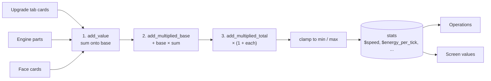

# Machine module: machine UI, faces and internals

> **Status: proposal, not built.** The screen pieces that [data-only machines](data-only-machines.md)
> need, plus two configuration systems: **face config** (per face: which groups it exposes, and
> face cards such as auto push, auto pull and filters) and **internals** (sockets for parts such
> as gears and motors that change the machine's stats). Element and key names are proposals.
> Today's screens are described in [GUI screens](../gui-screens.md).

## Three ways to change a machine, one set of stats

A player changes how a machine behaves in three places. All three feed the same named **stats**
(`speed`, `energy_per_tick`, `range`, ...), and operations read the results as `$speed` and so on.

| Place | Holds | Changes | Opened from |
|---|---|---|---|
| Upgrade tab | Tiered upgrade cards, one item per slot (today's `<side-tab>` upgrade slots) | Stats, machine-wide | Always visible |
| Face config | Per face: a mode for each group, and a few face-card slots | What automation may do on that face; cards move items on their own | A button that shows the faces view |
| Internals | Parts in sockets: gears, motor, coil, frame | Stats, machine-wide, with trade-offs | The engine view, with a wrench by default |



The three operations and their order are vanilla's attribute modifier operations, so a result
never depends on which part or card happened to be applied first.

This replaces the `modifiers` section from [data-only machines](data-only-machines.md): upgrades
become one more source of stat modifiers, and `$speed` there means the stat here.

## UI pieces

Already in MMDLib and reused as they are: `slot` (normal, ghost, upgrade), `gauge`, `meter`,
`progress`, `checkbox`, `radio-group`, `button`, `context`/`view`, `side-tab`, `popout`,
`side-config`.

New:

| Piece | Element (proposed) | For |
|---|---|---|
| Face configuration, face first | `<face-config>` | Pick a face, set each group's mode, manage that face's cards |
| Face card settings | sub-view opened from a card | Filter list, allow/deny, which groups a push or pull card moves |
| Free-placement layer and image | `<layer>`, `<image>`, `<socket>` | The engine cutaway: sockets placed on a drawing |
| Stat panel with preview | `<stats>` | Current stats, and what they become if the hovered part were installed |
| Operation status | `<op-status>` | State, reason and progress per operation ("Shear: blocked, output full") |
| Number control | `<number>` | Editing variables: −/+ buttons, Shift for ±10, min and max from the variable |
| Ghost slot with an amount | `slot kind="ghost" amount="true"` | "Keep 32 torches": left click +1, right click −1, Shift ×10, scroll |
| Per-player values | `$viewer.<name>` | Switches that differ per player, such as "restock me" |
| Area outline | handler `mmdlib:toggle_area` | Draws the machine's area in the world |
| Bucket on a tank | `gauge bucket-click="true"` | Click a tank gauge with a bucket or tank item to fill or drain it |
| Pause and redstone control | `<redstone-control>` | Built-in: ignore, high, low, pulse, plus pause; no mod handler needed |
| Upgrade tooltips | automatic | "Speed II: ×1.5 speed, ×1.5 energy" from the card's modifiers |
| World face overlay | automatic | Coloured faces on the block while holding a wrench or configurator |
| Configurator | item `mmdlib:configurator` | Copy a machine's face config and variables; paste onto another of the same type |

## Face config

### One table, two views

Under the screen, face config is one table: six relative faces × the machine's groups, with an
`IoMode` in each cell. Today's `<side-config>` view walks it group first (pick a group, set six
faces). `<face-config>` walks the same table face first (pick a face, set each group). Both views
edit the same data, so a screen can offer either or both.

| | Input slots | Output slots | Water tank | Energy |
|---|---|---|---|---|
| Top | In | Off | In | Off |
| Front | In | Off | Off | Off |
| Bottom | Off | Out | Off | Off |
| Back | Off | Off | Off | In |
| Left, Right | Off | Off | Off | Off |

A row is what face-first shows; a column is what group-first shows.

The table also gives MMDLib the per-slot mode that [capability wrappers](../capabilities.md)
lack today. Automation on a face asks for slot *n*; the view finds the group that owns slot *n*
and uses that group's mode on that face. Mods no longer combine group `SideConfig`s by hand in
the capability lambda. Slot numbering is unchanged: every face still shows every slot.

### The faces view

```text
┌ Faces ─────────────────────────────────────────────────┐
│          [ Top  ]        FRONT · next to: Chest        │
│ [Left][Front][Right][Back]                             │
│          [Bottom]        Input slots    [ In   ▸]      │
│                          Output slots   [ Off  ▸]      │
│                          Water tank     [ Off  ▸]      │
│                          Energy         [ Off  ▸]      │
│                          Face cards                    │
│                          [Push ✎] [Filter ✎]           │
│ [Copy face] [Paste] [Apply to all]                     │
└────────────────────────────────────────────────────────┘
```

- The face picker is an unfolded cube. Each tile shows a stripe per group that is not Off,
  coloured by mode, so the whole layout reads at a glance.
- The panel names the neighbouring block ("next to: Chest"), read on the server and synced with
  the menu.
- A mode button cycles only through the modes the group's role allows: an `OUTPUT` group offers
  Off and Out, an `INPUT` group Off and In, a `STORAGE` group all four.
- Copy, Paste and Apply to all work on one face's row. The configurator item copies the whole
  table between machines of the same type.

### Face cards

Face cards are real items in a few slots per face (2 by default). They act on that face only.

| Card | Does | Settings (in the card's sub-view) |
|---|---|---|
| `mmdlib:auto_push` | Moves contents out to the neighbour on this face | Which groups; rate and interval from the card's tier; keep N in the machine |
| `mmdlib:auto_pull` | Pulls from the neighbour into the machine | Which groups; rate and interval from tier; stop at N |
| `mmdlib:filter` | Limits what may pass through this face, both cards and outside pipes | Up to 9 ghost entries; allow or deny; match item, tag, or exact components |
| `mmdlib:redstone_gate` | The face is active only with (or without) a redstone signal | High or low |

- A card's settings are stored on the card item as a data component, so moving a card to another
  face or machine keeps them.
- A filter card is a property of the face: it applies to everything that passes through it, not
  only to the cards beside it.
- Card transfer runs as a built-in operation, `mmdlib:face_transfer`, so it shows in operation
  status and obeys the same budgets as every other operation.

Card items are ordinary items with a component; a pack makes its own tiers:

```json
"components": {
  "mmdlib:face_card": { "type": "mmdlib:auto_push", "rate": 16, "interval": 10 }
}
```

### Faces in the machine file

Startup part, next to `groups`:

```json
"faces": {
  "card_slots": 2,
  "cards": "#mmdlib:face_cards",
  "defaults": {
    "top":    { "input": "in", "water": "in" },
    "front":  { "input": "in" },
    "bottom": { "output": "out" },
    "back":   { "energy": "in" }
  }
}
```

Faces not listed default to Off for every group.

### Faces and ports

Ports gain a source that defers to the player:

```json
"ports": {
  "feed":   ["feed", { "faces": "pull" }],
  "output": ["output", { "faces": "push" }]
}
```

`{ "faces": "pull" }` means the neighbours on faces where this port's group is set to In (or
Both) and, if the face has filter cards, only what they allow. `"push"` is the same for Out. A pack
no longer hard-codes `{ "neighbors": "up" }`; the player decides which faces are used.

### World overlay

While a player holds a wrench or the configurator, the block's faces are tinted by mode (In
blue, Out orange, Both green, mixed striped), as in Mekanism. The face table is part of the block
entity's update packet, not only the menu, so the overlay works without opening the screen.

## Internals

### Sockets and stats

The machine declares sockets and the stats parts can change. Startup part:

```json
"internals": {
  "open_with": "#c:tools/wrench",
  "swap": "when_idle",
  "sockets": {
    "gears": { "count": 2, "accepts": "#c:gears" },
    "motor": { "count": 1, "accepts": "#example:motors" },
    "coil":  { "count": 1, "accepts": "#example:heating_coils", "optional": true }
  },
  "stats": {
    "speed":           { "base": 1.0, "min": 0.25, "max": 8 },
    "energy_per_tick": { "base": 40, "min": 1 },
    "max_temperature": { "base": 900 }
  }
}
```

- `open_with`: what the player must hold to open the engine view. Omit it to allow bare hands.
- `swap`: `always`, `when_idle` (default) or `never` (parts are fixed once installed). Progress is
  kept when a swap is allowed while running.
- A socket without `"optional": true` must be filled; an empty one stops every operation with the
  reason "Gears: none installed".

### Part files

Part files are datapack content under `data/<ns>/mmdlib/machine_part/`. MMDLib already makes
gears and other parts for every material, and materials already carry stats (`hardness`,
`strength`, `magic`, `damage`, and anything under `special`). So one template covers every
material's gear, with amounts worked out from the material:

```json
{
  "part": "mmdlib:gear",
  "socket": "gears",
  "modifiers": [
    { "stat": "speed",           "op": "add_multiplied_base", "amount": "0.08 * ($material.hardness - 3)" },
    { "stat": "energy_per_tick", "op": "add_multiplied_base", "amount": "0.03 * $material.hardness" }
  ],
  "durability": "500 * $material.hardness"
}
```

A file for one item overrides the template for that item:

```json
{
  "item": "example:diamond_coated_gear",
  "socket": "gears",
  "modifiers": [
    { "stat": "speed", "op": "add_multiplied_total", "amount": 0.4 },
    { "stat": "energy_per_tick", "op": "add_value", "amount": 12 }
  ]
}
```

### How stats combine

For each stat, starting from `base`:

1. Add every `add_value` amount.
2. Add (result of step 1) × the sum of every `add_multiplied_base` amount.
3. Multiply by (1 + amount) for each `add_multiplied_total` amount.
4. Clamp to `min` and `max`.

Worked example, with example hardness values (iron 4, bronze 5, invar 6, steel 7):

| Installed | speed | energy_per_tick |
|---|---|---|
| Base | 1.00 | 40 |
| 2 × iron gear (+0.08 each to step 2; energy +0.12 each) | 1.16 | 49.6 |
| 2 × invar gear (+0.24 each; energy +0.18 each) | 1.48 | 54.4 |
| + electrum motor (speed step 3 +0.15; energy step 1 +8) | 1.70 | 65.3 |
| + speed upgrade II in the upgrade tab (step 3 +0.5 to both) | 2.55 | 97.9 |

Operations read stats like variables:

```json
"crush": {
  "every": "40 / $speed",
  "consume": { "energy": { "amount": "$energy_per_tick", "per": "tick" } },
  "wear": { "gears": 1 }
}
```

Progress keeps fractions, so `40 / 2.55` (15.7 ticks) runs exactly as often over time as the
number says. `"wear": { "gears": 1 }` takes one point of durability from each part in the
`gears` socket per run. A part only wears if its file gives a `durability`; a part at zero is
removed and the socket is empty.

### The engine view

```text
┌ Engine ─────────────────────────────────────────────────┐
│ ┌ cutaway ─────────────────┐   Speed      1.16 → 1.32   │
│ │  gears  [iron] [iron]    │   Energy/t   49.6 → 52.0   │
│ │  motor  [copper motor]   │   Max temp   900 °C        │
│ │  coil   [ empty ]        │   Gear wear  ▮▮▮▮▮▮▯▯ 74%   │
│ └──────────────────────────┘   invar into gear slot 1   │
└─────────────────────────────────────────────────────────┘
```

- Sockets are real menu slots placed on a drawing with `<layer>`. A slot refuses pickup when
  `swap` forbids it, with the reason in its tooltip.
- **The preview is the point of the view.** Hovering a part, in a socket or in the player's
  inventory, shows what each stat would become if it went into the selected socket. Without it,
  nobody can tell whether invar beats iron.
- The preview is computed on the client, so part files and stat definitions are synced to
  clients on login and reload, like recipes. They are small.

## Other new widgets

| Widget | XML (proposed) | Notes |
|---|---|---|
| Operation status | `<op-status ops="feed shear milk"/>` | One row per operation: name, state pill, reason, progress |
| Number control | `<number var="max_adults" step="1" shift-step="10"/>` | Min and max come from the variable; changes go through `mmdlib:set_var` on the server |
| Ghost slot with amount | `<slot kind="ghost" index="20" amount="true"/>` | Amount stored with the ghost filter; shown as the stack count |
| Per-player switch | `<checkbox value="$viewer.restock" on-click="mmdlib:toggle_viewer_var" var="restock"/>` | Stored by player UUID in the machine; each viewer sees their own |
| Area outline | `<button on-click="mmdlib:toggle_area" .../>` | The area box is in the block entity's update packet |
| Bucket on a tank | `<gauge bucket-click="true" .../>` | Uses the tank's role: output tanks only drain into the container |
| Redstone and pause | `<redstone-control/>` | Built-in variables `redstone` and `paused`; operations skip while paused or gated |

Proposed XML for the two new views:

```xml
<view id="faces" title="screen.mmdlib.faces">
  <face-config groups="input output water energy"/>
</view>

<view id="engine" title="screen.mmdlib.engine">
  <hbox spacing="6">
    <layer width="7s" height="4s">
      <image sprite="example:crusher_cutaway"/>
      <socket name="gears" index="0" x="20" y="14"/>
      <socket name="gears" index="1" x="42" y="14"/>
      <socket name="motor" x="20" y="40"/>
      <socket name="coil" x="64" y="40"/>
    </layer>
    <stats show="speed energy_per_tick max_temperature" preview="hover"/>
  </hbox>
</view>
```

`<layer>` is the one place where children are placed by `x`/`y` instead of boxes; it has a fixed
size, and the loader checks every child fits inside it.

## Server rules

- Every change goes through a server-checked `gui-click` handler: modes, card settings, numbers,
  switches. A player who could not open the screen cannot change anything.
- Face cards and parts are real items in real menu slots, so duplication rules are vanilla's.
- Mode cycling, card settings and stat results are validated on the server; the client only
  previews.
- When a machine is broken, cards and parts drop with its other contents. Wrench-picking a
  machine keeps them in the item, as configured per mod.

## Cost

These follow phase 14 of [data-only machines](data-only-machines.md#cost).

| # | Work | Estimate |
|---|---|---|
| 15 | Face table, per-slot mode in the capability views, `<face-config>`, Copy/Paste/Apply to all, `faces` port source, world overlay | about 1.5 weeks |
| 16 | Face cards: items and component, card slots per face, sub-view for card settings, `mmdlib:face_transfer`, filter applying to pipes | 1–1.5 weeks |
| 17 | Internals: sockets, part files with material templates, stat pipeline, wear, swap rules, `<layer>`/`<image>`/`<socket>`, `<stats>` with client preview and part sync | 1.5–2 weeks |
| 18 | The other widgets: op status, number, ghost amount, viewer values, area outline, bucket on tank, redstone and pause, upgrade tooltips, configurator | about 2 weeks |
| | **Total** | **6–7 weeks** |

## Recommendations for the open choices

- **Offer both face views.** They edit the same table; face first is easier for "what touches this
  chest", group first for "where does output go".
- **Filters apply to pipes too.** A filter card describes the face, not the cards next to it.
- **Two card slots per face by default.** Three per face is 18 slots, too much for the screen.
- **Engine opens with a wrench and swaps only when idle.** Packs can change both.
- **Wear only where a part file says so.** Most packs will want parts that don't wear.
