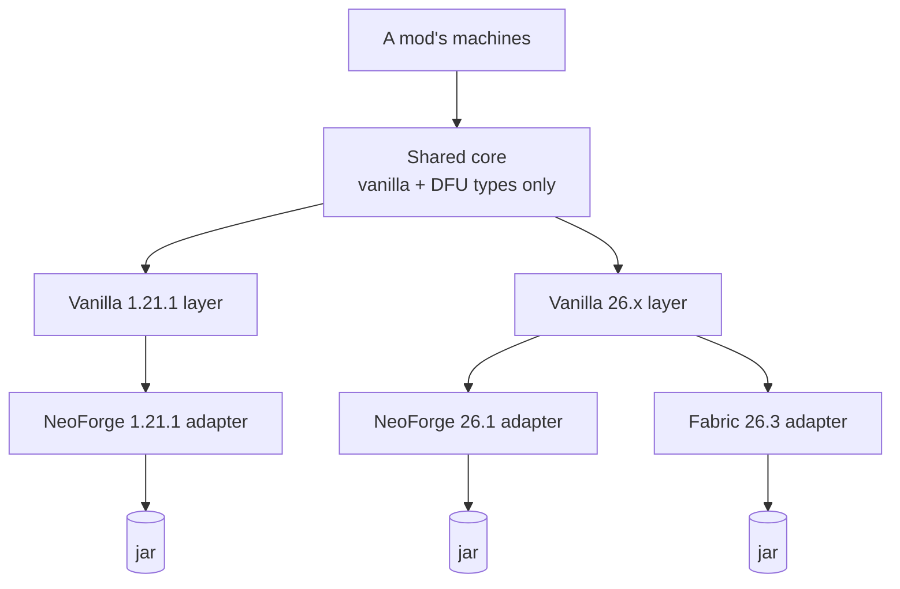

# Machine module: rebuild plan

> **Status: plan, nothing built.** Rebuilds Tesla-Core-Lib's unfinished 2017 ingredients,
> inventory and recipe system (`net.modcrafters.mclib`) as a machine module in MMDLib, for
> NeoForge 1.21.1, NeoForge 26.1 and Fabric 26.3. Type names are proposals. How the system works
> is in [recipes](recipes.md); the JSON-only machine layer on top is in
> [data-only machines](data-only-machines.md).

Almost everything mclib stands on is gone from modern Minecraft: metadata, the ore dictionary,
`ASMDataTable`, `ITickable`, `IForgeRegistry`. The plan keeps its design and rebuilds it. A
shared core holds the logic; a vanilla layer per Minecraft version and a thin adapter per mod
loader sit under it. Stonecutter builds three jars from one tree.

## Decisions

| Decision | Choice | Why |
|---|---|---|
| Home | MMDLib, package `zone.moddev.mc.lib.machine` | MMDLib already has the storages, side config, screens and JEI support; this is the missing layer on top |
| Language | Java | Matches MMDLib, and avoids waiting on Kotlin for Forge to support 26.1. Records and sealed types cover what Kotlin gave mclib |
| Targets | NeoForge 1.21.1, NeoForge 26.1, Fabric 26.3 | The two NeoForge versions modpacks settle on, plus Fabric's latest. Fabric 1.21.1 and 1.21.2–1.21.11 are left out |
| Build | Stonecutter, with ModDevGradle for NeoForge and Fabric Loom (the non-remapping `net.fabricmc.fabric-loom`) for Fabric | MMDLib moves off NeoGradle userdev first |

## Shape

Three layers. The core never mentions a Minecraft version or a loader. A vanilla layer per
Minecraft version holds what changed in vanilla, such as saving and the recipe interface, and is
shared by every loader on that version. A loader adapter holds what differs between NeoForge and
Fabric: inventory APIs, how capabilities are exposed, and registration. Each jar is the core plus
one vanilla layer plus one loader adapter.



Minecraft 26.x is unobfuscated, so NeoForge and Fabric code use the same Mojang names and nothing
is remapped. The two 26.x jars share everything above the loader row.

The core may import only vanilla and DataFixerUpper types that mean the same on every target:
`Codec`/`MapCodec`, `StreamCodec`, `ItemStack`, `Item`, `Ingredient`, `TagKey`, `HolderSet`,
`Holder`, `DataComponentPatch`, `RandomSource`. Fluids use core-owned types (`FluidAmount`, and a
`HolderSet<Fluid>` for matching), because NeoForge's `FluidStack` and `FluidIngredient` don't
exist on Fabric. The one unavoidable difference, `ResourceLocation` becoming `Identifier` in
1.21.11, is a Stonecutter swap, not a per-file conditional. An import allowlist check in
`./gradlew check` keeps the rule honest.

## Fabric on 26.x: viable, about 3–4 extra weeks

Fabric costs more than a fourth adapter would suggest, because MMDLib itself has to run on Fabric
before its machine module can. It is still viable:

- **Same names.** 26.x ships unobfuscated, so both loaders compile against identical Minecraft
  names. No mappings, no remapping; vanilla code is shared as-is.
- **Twin transfer APIs.** NeoForge's 21.9 transfer rework followed Fabric's Transfer API:
  resource keys, amounts and nested transactions. The NeoForge 26.1 and Fabric adapters come out
  nearly line for line alike.
- **MMDLib is mostly vanilla already.** 35 of its 193 Java files import NeoForge. The other 158
  use only vanilla code.

Where the cost is, in those 35 files:

| MMDLib area | NeoForge today | Fabric 26.3 |
|---|---|---|
| Registration (16 files) | `DeferredRegister` | `Registry.register` at init, behind a small MMDLib registrar |
| Events (9 files) | NeoForge event bus | Fabric API callbacks, behind a platform hook per event MMDLib uses |
| Storages and capabilities (~10 files) | `ItemStackHandler`, `FluidTank`, capabilities | `Storage<ItemVariant>` / `Storage<FluidVariant>` through `ItemStorage.SIDED` / `FluidStorage.SIDED`; energy through Team Reborn Energy (verify on 26.3) |
| Menus and network (3 files) | NeoForge payload registration, menu with extra data | Fabric networking payloads, Fabric's extended menu type |
| Client hooks (4 files) | Client events, client extensions (fluid rendering) | Fabric client callbacks and fluid render handlers |
| Loading, config, data (~5 files) | FML mod discovery, config, data run | Fabric Loader mod list, a config of MMDLib's own, Fabric datagen or the generated files from the NeoForge 26.x run |

The storages are the largest item, and NeoForge 26.1 forces their rewrite anyway because
`ItemStackHandler` is replaced by the transfer API there. Writing the 26.x storages as plain
MMDLib classes with a thin wrapper per loader costs a few extra days in that port and makes the
Fabric storage work mostly wrappers.

## Core interfaces

Names map to mclib's where the idea carried over.

### Ingredients

```java
// zone.moddev.mc.lib.machine.ingredient
/** Some amount of something a machine consumes. */
public sealed interface MachineIngredient permits ItemPart, FluidPart, EnergyPart {
  long amount();
  MapCodec<MachineIngredient> CODEC = ...;   // {"items": …, "count"} | {"fluids": …, "amount"} | {"energy"}
}
public record ItemPart(Ingredient items, int count) implements MachineIngredient {}
public record FluidPart(HolderSet<Fluid> fluids, int amount) implements MachineIngredient {}   // mB
public record EnergyPart(long amount) implements MachineIngredient {}

/** A fluid and an amount in mB, on every loader. Fabric's adapter converts: 1 mB = 81 droplets. */
public record FluidAmount(Holder<Fluid> fluid, DataComponentPatch components, int amount) {}

public enum AmountMatch {
  EXACT,       // available == required          (mclib EXACT)
  AT_LEAST,    // available >= required          (mclib BE_ENOUGH)
  ANY_AMOUNT;  // kind matches, amount ignored   (mclib IGNORE_SIZE)
  public boolean test(long required, long available) { ... }
}
```

### Inventory and transactions

```java
// zone.moddev.mc.lib.machine.inventory
/** A machine's storages, grouped under the keys its recipes use ("input", "water", "energy"). */
public interface MachineInventory {
  Optional<SlotGroup> group(String key);
  MachineTx begin();
}

public sealed interface SlotGroup permits ItemGroup, FluidGroup, EnergyGroup {}
public non-sealed interface ItemGroup extends SlotGroup {
  int size();
  ItemStack peek(int slot);                         // read only
  int extract(int slot, int count, MachineTx tx);   // returns how many were taken
  int insert(ItemStack stack, MachineTx tx);        // returns how many fitted
}
// FluidGroup: the same with FluidAmount, in mB. EnergyGroup: stored(), extract(long, tx), insert(long, tx).

/** Changes made under one tx land together, or not at all. */
public interface MachineTx extends AutoCloseable {
  void commit();
  @Override void close();   // closing without commit() undoes everything in this tx
}
```

### Recipes and matching

```java
// zone.moddev.mc.lib.machine.recipe
public record MachineRecipe(
    Map<String, List<MachineIngredient>> inputs,   // group key -> what it must hold
    Map<String, List<MachineProduct>> outputs,     // group key -> what it receives
    int time) {                                     // ticks
  public static final MapCodec<MachineRecipe> CODEC = ...;
  public static final StreamCodec<RegistryFriendlyByteBuf, MachineRecipe> STREAM_CODEC = ...;
}

public sealed interface MachineProduct permits ItemProduct, FluidProduct {
  float chance();   // 1.0 unless rolled
}

public final class RecipeMatcher {
  /** Inputs present and room for every possible output; changes nothing. */
  public static MatchResult check(MachineRecipe recipe, MachineInventory inventory) { ... }
  /** Takes the item and fluid inputs, all or nothing. Energy is drawn per tick. */
  public static boolean consume(MachineRecipe recipe, MachineInventory inventory) { ... }
  /** Rolls chances and inserts the outputs, all or nothing. */
  public static boolean produce(MachineRecipe recipe, MachineInventory inventory, RandomSource random) { ... }
}

/** Why a recipe can't run: the group and the ingredient that failed, for the screen. */
public record MatchResult(boolean ok, @Nullable String group, @Nullable MachineIngredient missing) {}
```

### Features

```java
// zone.moddev.mc.lib.machine.feature
public interface MachineFeature<S> {
  String key();
  Codec<S> codec();            // the vanilla layer stores it as CompoundTag or ValueOutput
  S state();
  void restore(S state);
  default void tick(FeatureHost host) {}
  default boolean syncsToClient() { return false; }
}

/** Owned by the block entity (composition, not a base class): ticks, saves and syncs features. */
public final class FeatureHost { ... }

/** The standard processing loop: find, consume, run for recipe.time() ticks, produce. */
public final class RecipeProcessor implements MachineFeature<RecipeProcessor.State> { ... }

/** Registers a mod's recipe type and serializer through the loader's own registration. */
public static MachineRecipeType register(String modId, String name) { ... }
```

## What each build does differently

Everything that differs between the three jars, and nothing else. "Verify" marks rows that depend
on 26.x API details that are still settling; check them when that phase starts.

| Concern | NeoForge 1.21.1 | NeoForge 26.1 | Fabric 26.3 |
|---|---|---|---|
| Item groups | Slot ranges of MMDLib's `ItemStorage`, used directly (the machine bypasses roles) | Slot ranges of MMDLib's 26.x storage, exposed as `ResourceHandler<ItemResource>` | The same 26.x storage, exposed as `Storage<ItemVariant>` |
| Fluid groups | `FluidStorage.tank(i)`, mB | `ResourceHandler<FluidResource>`, mB | `Storage<FluidVariant>`; droplets ÷ 81 = mB |
| Energy group | `EnergyBuffer` (`long`) | NeoForge `EnergyHandler` | Team Reborn Energy `EnergyStorage` (verify) |
| `MachineTx` | Copies a slot or tank the first time a tx touches it and restores the copies on close without commit | Wraps `Transaction.openRoot()` | Wraps `Transaction.openOuter()`; MMDLib storages take part through `SnapshotParticipant` |
| Exposing to pipes | `RegisterCapabilitiesEvent` (today's `MachineCapabilities`) | Same event, transfer-API types | `ItemStorage.SIDED`, `FluidStorage.SIDED`, `EnergyStorage.SIDED` lookups |
| Registration | `DeferredRegister` | Same | `Registry.register` during mod init |
| Saving features | `codec` + `NbtOps` into the `CompoundTag` in `saveAdditional` | `ValueOutput.store(key, codec, state)`, `ValueInput.read(key, codec)` (verify) | Same; it's vanilla |
| Client sync | Update tag and `ClientboundBlockEntityDataPacket` for features that ask; screen values keep MMDLib's getter sync | Same approach (verify) | Same; payloads registered through Fabric networking |
| Recipe type | A vanilla `Recipe` wrapper; serializer built from `CODEC` / `STREAM_CODEC` | The `Recipe` interface changed in 1.21.2 (placement info, displays) (verify) | Same; it's vanilla |
| Recipe lookup | All recipes of the type from `RecipeManager`, run through `RecipeMatcher`, last match cached | Same on the server | Same |
| Recipe viewers | JEI reads recipes on the client | Recipes aren't sent to the client after 1.21.2; needs a sync payload or JEI's 26.x route (verify) | Same payload. JEI, EMI and REI all exist on Fabric; start with JEI (verify on 26.3) |
| Recipe JSON | Item ingredients as `{"tag": "c:ores/copper"}` | `"#c:ores/copper"` (changed in 1.21.2) | Same; one datagen output can serve both 26.x jars if the versions match |
| Names | `ResourceLocation` | `Identifier`, through a Stonecutter swap | Same |

## Stonecutter layout

Stonecutter runs one Gradle subproject per build node over the same source tree. Each node is a
Minecraft version plus a loader. Source folders are chosen per node in the build scripts, so most
differences are whole files rather than comment conditionals inside files.

```text
MMDLib/
├─ settings.gradle.kts      three nodes
├─ stonecutter.gradle.kts   active node for the IDE
├─ neoforge.gradle.kts      ModDevGradle script
├─ fabric.gradle.kts        Fabric Loom script
├─ versions/
│  ├─ 1.21.1-neoforge/gradle.properties
│  ├─ 26.1-neoforge/gradle.properties
│  └─ 26.3-fabric/gradle.properties
└─ src/
   ├─ main/java/            core: every node
   ├─ mc-1.21.1/java/       vanilla 1.21.1
   ├─ mc-26/java/           vanilla 26.x
   ├─ neoforge-1.21.1/java/ loader
   ├─ neoforge-26/java/     loader
   └─ fabric-26/java/       loader
```

`settings.gradle.kts`:

```kotlin
plugins {
    id("dev.kikugie.stonecutter") version "<pinned>"
}
stonecutter {
    create(rootProject) {
        // node name, Minecraft version
        version("1.21.1-neoforge", "1.21.1").buildscript = "neoforge.gradle.kts"
        version("26.1-neoforge", "26.1").buildscript = "neoforge.gradle.kts"
        version("26.3-fabric", "26.3").buildscript = "fabric.gradle.kts"
        vcsVersion = "1.21.1-neoforge"
    }
}
```

Stonecutter's DSL changed between 0.6 and 0.7 (`vers` became `version`), and the per-node build
script setting is spelled differently across releases. Pin one release and check its docs.

Picking source folders, shared by both build scripts:

```kotlin
val mc = stonecutter.current.version
val is26 = stonecutter.eval(mc, ">=26.1")
val loader = project.name.substringAfter('-')   // "neoforge" or "fabric"
sourceSets.main {
    java.srcDir(rootProject.file("src/mc-" + (if (is26) "26" else "1.21.1") + "/java"))
    java.srcDir(rootProject.file("src/$loader-" + (if (is26) "26" else "1.21.1") + "/java"))
}
java.toolchain.languageVersion = JavaLanguageVersion.of(if (is26) 25 else 21)
```

When a conditional is unavoidable:

```java
//? if >=26.3 {
/*recipeSync.sendAll(server);
*///?} else {
recipeSync.sendAll(server.getRecipeManager());
//?}
```

Stonecutter comments out the branch that doesn't apply and uncomments the other when you switch
the active node. Keep these out of the core. The shared 26.x layer is where they appear, because
NeoForge is on 26.1 and Fabric on 26.3; the example is illustrative. For the `Identifier` rename,
use Stonecutter's string swap so the 74 files that mention `ResourceLocation` need no markers.

## Phases

Each phase ends with something that runs. Phases 1 to 4 stay on NeoForge 1.21.1 and are useful
even if nothing else happens. Estimates are guesses for one person part-time, not commitments.

| # | Build | Work | Done when | Estimate |
|---|---|---|---|---|
| 1 | core | `MachineIngredient` and its codec, core-owned fluid types, `AmountMatch`, `MachineInventory` over `ItemStorage`, `FluidStorage` and `EnergyBuffer`, the snapshot `MachineTx`, `RecipeMatcher` | The smoke test covers every matching rule, a full output slot rolls back the whole tx, and energy above 2³¹ works | ~1 week |
| 2 | core, neo 1.21.1 | `MachineRecipe` codecs, `MachineRecipeType.register`, cached lookup, a JEI category helper, a datagen provider; move `mmdlib:crushing` onto it | Crushing runs through the new path and looks the same in JEI | ~1 week |
| 3 | core | `FeatureHost`, `RecipeProcessor` (consume, per-tick energy, stall, produce), save and sync through codecs, a progress getter for XML screens | The example crusher keeps its progress across save and reload and shows it on screen | 3–5 days |
| 4 | neo 1.21.1 | NeoGradle userdev to ModDevGradle, then Stonecutter with `1.21.1-neoforge` as its only node; code moved into `src/mc-1.21.1` and `src/neoforge-1.21.1`. No behaviour changes | `./gradlew check` passes and a dev client behaves as before | 2–3 days |
| 5 | neo 26.1 | Storages rewritten as plain MMDLib classes with a NeoForge transfer-API wrapper, so Fabric can reuse them. Then saving (5 files with `CompoundTag`), screen drawing (3 files use `GuiGraphics`), the `Identifier` swap (74 files), datagen and JEI | Both NeoForge jars build from one tree and the example machine works in each | 2–4 weeks (least certain) |
| 6 | neo 26.1 | Vanilla 26.x layer (`ValueOutput` saving, the new `Recipe` wrapper, recipe sync for viewers) and the NeoForge 26.1 adapter (transfer-API groups, `Transaction`-backed `MachineTx`) | The same smoke test passes on both NeoForge jars | ~1 week |
| 7 | fabric 26.3 | The `26.3-fabric` node with Fabric Loom, and the platform layer for the 35 NeoForge-dependent files: registrar, event hooks, storage wrappers and `SIDED` lookups, networking, menus, client hooks, mod discovery, config | The example machine opens its screen and accepts items and fluids from a Fabric pipe mod | 2–3 weeks |
| 8 | fabric 26.3 | Fabric item, fluid and energy groups (with droplet conversion), `MachineTx` on Fabric's `Transaction`, recipe viewer support | The smoke test passes on all three jars | 3–5 days |

Fabric adds phases 7 and 8 (about 3–4 weeks) plus a few days in phase 5. Phases 9–14, the
JSON-only machine layer, are in [data-only machines](data-only-machines.md#cost). Tesla-Core-Lib
stays on 1.12 as it is; only the design comes across.

## mclib's defects, and why they don't come back

| # | mclib on 1.12 | In the rebuild |
|---|---|---|
| 1 | Item extraction always returns nothing | Extraction goes through `ItemGroup.extract` under a tx, covered by the phase 1 test |
| 2 | `isMatch` and `canStart` return `Unit` | Java return types are checked; `check` returns a `MatchResult` |
| 3 | Shaped recipe input is empty | No shaped machine recipes in v1; machines rarely need them |
| 4 | Ticking machines can't add per-tick work | No base class to override; features tick through `FeatureHost` |
| 5 | Feature sync is sent but never read | The vanilla layer owns both directions, tested as a round trip |
| 6 | Two separate "dirty" sets | One `FeatureHost` owns change tracking |
| 7 | Registry crashes before it exists; duplicate-name option ignored | No custom registry; recipes are datapack recipes in `RecipeManager` |
| 8 | Fluid extraction ignores the chosen tank | `FluidGroup.extract` takes a tank index |
| 9 | Energy cast from `long` to `int` | `long` throughout, as in `EnergyBuffer` |
| 10 | Ingredient factory interfaces never implemented | Codecs replace factories; data files replace the string format |

## Open questions

- **NeoForge 26.1, Fabric 26.3.** Fabric's latest is 26.3 (Fabric API `0.163.0+26.3`). NeoForge
  has 26.3 only as beta builds. Two 26.x versions put a few conditionals in the shared 26.x layer.
  When NeoForge 26.3 is stable, consider moving the NeoForge node to it.
- **Energy on Fabric.** Fabric API has no energy API. Team Reborn Energy is the usual choice,
  normally bundled inside the mod's jar. Check that it has a 26.3 build before phase 7.
- **Recipe viewers on 26.x.** With recipes kept on the server, how JEI (and EMI or REI on Fabric)
  receive machine recipes decides part of the 26.x layer. Check their 26.x APIs first.
- **Droplet rounding.** Fabric tanks can hold amounts that aren't whole mB. The Fabric adapter
  rounds down when reading and only moves whole mB.
- **NeoForge 26.1 is still moving.** Its builds are numbered `26.1.0.x-beta`. Start phase 5
  against the newest release and re-check every "verify" row first.
- **Energy per tick or up front.** The plan draws energy evenly over the recipe's time and pauses
  without it, like most tech mods. Taking it all at the start is simpler. Decide before phase 3.

## Sources for version facts

- [NeoForge: The Transfer Rework (21.9)](https://neoforged.net/news/21.9-transfer-rework/)
- [NeoForge for Minecraft 26.1](https://neoforged.net/news/26.1release/) (unobfuscated, Java 25, Gradle 9.1)
- [Fabric API 0.163.0+26.3](https://modrinth.com/mod/fabric-api/version/0.163.0+26.3),
  [Fabric porting docs](https://docs.fabricmc.net/develop/porting/),
  [Fabric for 1.21.11](https://fabricmc.net/2025/12/05/12111.html) (the non-remapping Loom)
- [Team Reborn Energy](https://github.com/TechReborn/Energy)
