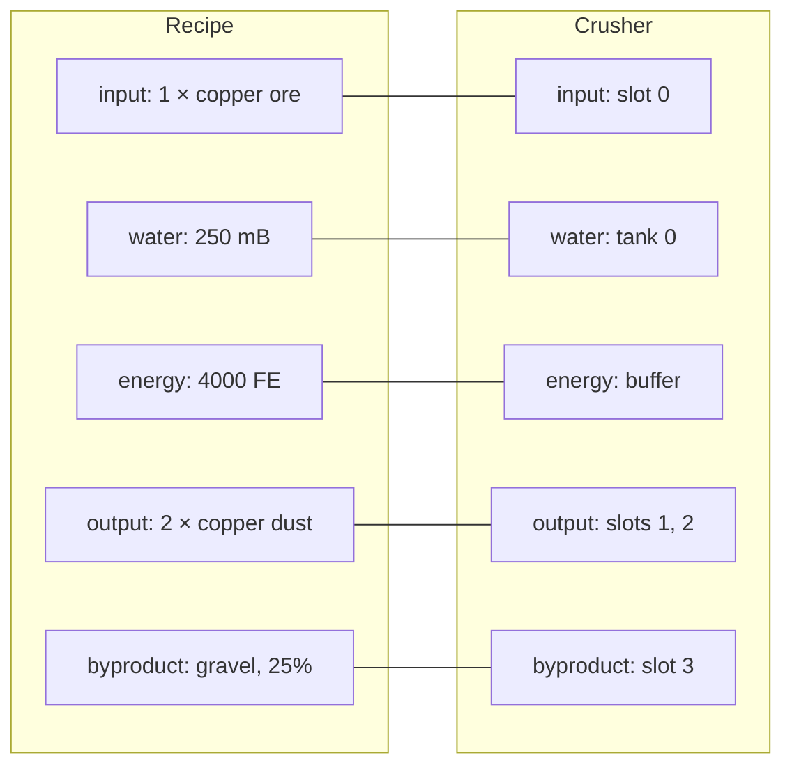
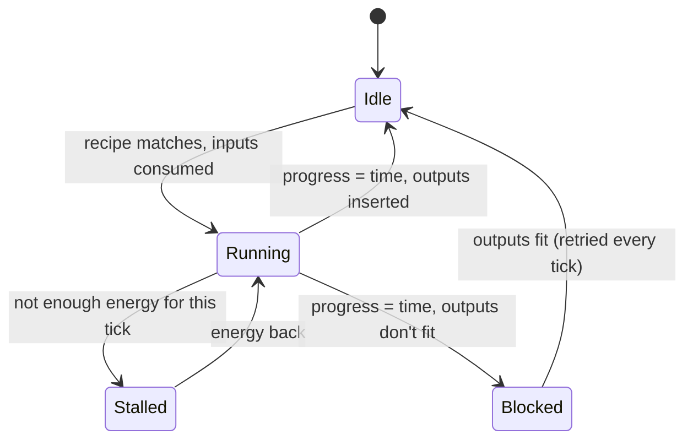
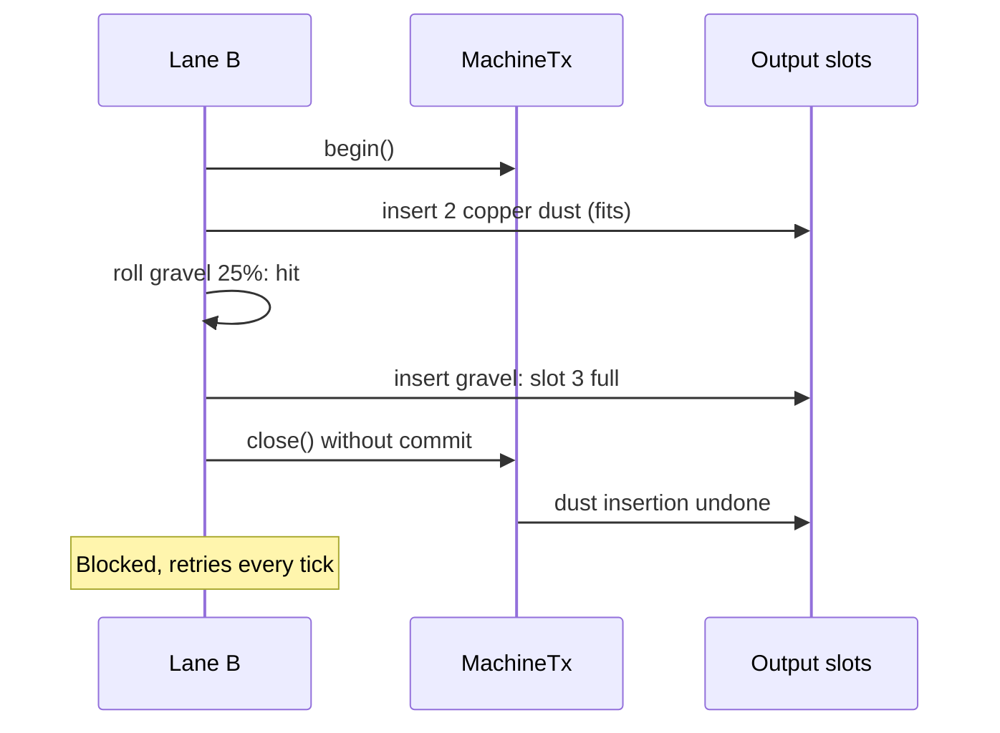

# Machine module: how recipes work

> **Status: proposed design, not implemented.** Explains the design from the
> [rebuild plan](rebuild-plan.md). `ItemStorage`, `FluidStorage`, `EnergyBuffer`, `Role` and
> `ScreenHost` exist today; every other type name is a proposal.

A machine recipe lists what each part of a machine must hold and what each part receives. The
machine names its storages with the same keys. A matcher joins the two by key, and every change
runs inside a transaction, so a recipe either runs completely or leaves nothing changed.

The example throughout is a crusher that turns copper ore and water into copper dust, with gravel
as a chance byproduct. The same recipes and machine code are meant to work on all three planned
builds (NeoForge 1.21.1, NeoForge 26.1, Fabric 26.3); where they differ, this page says so.

## The key is the join

A recipe never says "slot 0" or "tank 0". It names groups: `input`, `water`, `energy`, `output`,
`byproduct`. The block entity decides which of its slots, tanks and buffers make up each group.
That keeps recipes independent of slot layouts, and lets one recipe type serve machines laid out
differently.



Matching is by key only. If a recipe names a key the machine doesn't have, that recipe never
matches for that machine.

Groups are separate from MMDLib's automation rules. Pipes and hoppers still go through
`ItemStorage.view(...)`, where slot `Role`s and side `IoMode`s apply. Recipes run as the machine
itself, which bypasses roles the same way `insertResult` does today.

## Three kinds of ingredient

Every input is a `MachineIngredient`: one of three record types, each with an amount. Treating
energy as an ingredient was mclib's best idea and it stays: a recipe's power cost lives in the
recipe file, next to its items and fluids.

| Kind | Amount | Holds | JSON |
|---|---|---|---|
| `ItemPart` | count | A vanilla `Ingredient` (an item, a tag, or a custom ingredient) | `{ "items": { "tag": "c:ores/copper" }, "count": 1 }` |
| `FluidPart` | mB | A set of fluids (one id, a `#tag`, or a list) | `{ "fluids": "minecraft:water", "amount": 250 }` |
| `EnergyPart` | FE, `long` | Only an amount; costs above 2,147,483,647 FE work | `{ "energy": 4000 }` |

Tags replace mclib's `__ore:` entries, and items have no metadata since the flattening, so the
old `modid:path$meta#count` strings are gone. The item JSON above is the 1.21.1 shape; on 26.x
vanilla item ingredients are written `"#c:ores/copper"`, and datagen writes the right shape for
each version. Fluid and energy parts are MMDLib's own format and look the same everywhere. Fabric
measures fluids in droplets (81,000 per bucket); its adapter converts, so recipes and screens
always use mB.

## How amounts are compared

The kind must match first: the item, fluid or energy has to be what the ingredient accepts. Then
`AmountMatch` compares the amount the recipe requires with the amount the group holds. Recipes
use `AT_LEAST`; the other two are for code that asks narrower questions.

| Mode (mclib name) | Rule | Requires 4, holds 3 | holds 4 | holds 6 |
|---|---|---|---|---|
| `EXACT` (`EXACT`) | held = required | no | yes | no |
| `AT_LEAST` (`BE_ENOUGH`) | held ≥ required | no | yes | yes |
| `ANY_AMOUNT` (`IGNORE_SIZE`) | kind only | yes | yes | yes |

mclib's names described the comparison from the wrong side ("source ≤ target"), which made them
easy to call backwards. The new names read from the recipe's side.

What a group "holds":

- **Items:** the total across all of the group's slots of the stacks the `Ingredient` accepts.
  Two item parts in one group can't count the same items: each claims what it needs before the
  next looks.
- **Fluids:** the total across the group's tanks of fluids in the part's fluid set, in mB.
- **Energy:** what the buffer stores. The processor only needs one tick's share to start (here
  4,000 ÷ 200 = 20 FE), because energy is drawn as the recipe runs.

## One processing cycle

`RecipeProcessor` is a machine feature that runs this loop every tick. Items and fluids are taken
when the recipe starts. Energy is drawn evenly while it runs. Outputs are inserted when it
finishes.



Stalled keeps its progress; nothing is lost while power is out. Blocked should be rare, because a
recipe only starts when `check` finds room for every possible output, but it can happen when
something else fills the output slots meanwhile.

## A worked run

The crusher starts with 3 copper ore, 1,000 mB of water and 3,000 FE, with nothing charging it.
The recipe needs 4,000 FE in total, so it runs out partway.

| Tick | State | Progress | Ore | Water | Energy | What happens |
|---|---|---|---|---|---|---|
| 0 | Running | 0 / 200 | 3 → 2 | 1,000 → 750 | 3,000 | Recipe matches; one transaction takes 1 ore and 250 mB |
| 1 | Running | 1 / 200 | 2 | 750 | 2,980 | 20 FE drawn |
| 150 | Running | 150 / 200 | 2 | 750 | 0 | The last 20 FE is used |
| 151–160 | Stalled | 150 / 200 | 2 | 750 | 0 | Not enough for a tick; progress holds |
| 161 | Running | 151 / 200 | 2 | 750 | 180 | A generator starts supplying 200 FE each tick; 20 of it is drawn |
| 210 | Idle | 200 / 200 | 2 | 750 | 9,000 | Done. 2 copper dust go into the output; gravel rolled 25% and missed |
| 211 | Running | 0 / 200 | 2 → 1 | 750 → 500 | 9,200 | The next ore starts straight away. The starting tick draws no energy |

Energy at tick 210: 50 running ticks at +200 −20 = 9,000.

## All or nothing

Consuming and producing each happen inside one `MachineTx`. If any step fails, closing the
transaction without committing undoes every step before it. Code that runs a recipe never has to
clean up a half-finished one.

Example: a two-lane crusher shares its output slots between two processors. Both lanes started
when there was room for one more set of outputs. Lane A finishes first and fills the room. Then
lane B finishes:



When a hopper empties slot 3, the whole set goes in at once. The chance is rolled again on each
retry.

How each build implements `MachineTx`:

- **NeoForge 1.21.1.** Item and fluid handlers only know "simulate" or "do it". The adapter
  copies each slot or tank the first time a transaction touches it, and puts the copies back if
  the transaction closes without commit. This is exact because the machine owns those storages.
- **NeoForge 26.1.** Real transactions since the 21.9 transfer rework. `MachineTx` wraps
  `Transaction.openRoot()`, and NeoForge handles the rollback.
- **Fabric 26.3.** Fabric's Transfer API has had transactions for years. `MachineTx` wraps
  `Transaction.openOuter()`; MMDLib's storages join as `SnapshotParticipant`s.

```java
// What RecipeMatcher.produce does, simplified
try (MachineTx tx = inventory.begin()) {
  for (var entry : recipe.outputs().entrySet()) {
    ItemGroup group = (ItemGroup) inventory.group(entry.getKey()).orElseThrow();
    for (MachineProduct product : entry.getValue()) {
      if (product instanceof ItemProduct item && random.nextFloat() < item.chance()) {
        ItemStack stack = item.stack().copy();
        if (group.insert(stack, tx) < stack.getCount()) {
          return false;        // close() without commit(): the dust comes back out
        }
      }
    }
  }
  tx.commit();
  return true;
}
```

## The crusher, end to end

What a mod would write for NeoForge 1.21.1. The storages are MMDLib's as they exist today; the
rest is the proposed API.

The recipe file, written by datagen to `data/example/recipe/crushing/copper.json`:

```json
{
  "type": "example:crushing",
  "inputs": {
    "input":  [ { "items": { "tag": "c:ores/copper" }, "count": 1 } ],
    "water":  [ { "fluids": "minecraft:water", "amount": 250 } ],
    "energy": [ { "energy": 4000 } ]
  },
  "outputs": {
    "output":    [ { "item": { "id": "example:copper_dust", "count": 2 } } ],
    "byproduct": [ { "item": { "id": "minecraft:gravel", "count": 1 }, "chance": 0.25 } ]
  },
  "time": 200
}
```

Registering the recipe type. MMDLib registers the type and its serializer the loader's way:
`DeferredRegister` on NeoForge, `Registry.register` on Fabric.

```java
public static final MachineRecipeType CRUSHING = MachineRecipeType.register("example", "crushing");
```

The block entity:

```java
public class CrusherEntity extends BlockEntity implements ScreenHost {
  final ItemStorage items = new ItemStorage(4)
      .onChange(this::setChanged)
      .role(Role.INPUT, 0)
      .role(Role.OUTPUT, 1, 2, 3);
  final FluidStorage tanks = new FluidStorage().onChange(this::setChanged);
  final EnergyBuffer energy = new EnergyBuffer(10_000, 200).onChange(this::setChanged);
  { tanks.addTank(4_000, Role.INPUT); }

  // Group keys: the same names the recipe file uses
  final MachineInventory inventory = MachineInventories.builder()
      .items("input", items, 0)
      .items("output", items, 1, 2)
      .items("byproduct", items, 3)
      .fluids("water", tanks, 0)
      .energy("energy", energy)
      .build();
  final RecipeProcessor processor = new RecipeProcessor("work", ExampleRecipes.CRUSHING, inventory);
  final FeatureHost features = new FeatureHost(this::setChanged).add(processor);

  static void serverTick(Level level, BlockPos pos, BlockState state, CrusherEntity be) {
    be.features.tick(level);
  }

  // For the XML screen's progress gauge
  public int getProgress() { return processor.progress(); }
  public int getMaxProgress() { return processor.time(); }

  @Override
  protected void saveAdditional(CompoundTag tag, HolderLookup.Provider registries) {
    super.saveAdditional(tag, registries);
    tag.put("Items", items.serializeNBT(registries));
    tag.put("Tanks", tanks.serializeNBT(registries));
    tag.put("Energy", energy.serializeNBT(registries));
    features.save(tag, registries);   // progress and current recipe, through each feature's codec
  }
  // loadAdditional mirrors it; ScreenHost and capability registration as in machines.md
}
```

On 26.x the block entity changes only where MMDLib's storages and saving change (`ValueOutput`
instead of `CompoundTag`). That code is vanilla on 26.x, so one block entity compiles for both
NeoForge 26.1 and Fabric 26.3. Exposing the storages to pipes is the one loader-specific step,
and MMDLib's `MachineCapabilities` helper hides it.

## Where each mclib idea went

| mclib (Tesla-Core-Lib 1.12) | Rebuild | Why |
|---|---|---|
| `IMachineIngredient` | `MachineIngredient` (sealed) | Same idea; the compiler knows every kind |
| `ItemIngredient`, `OreItemIngredient`, `RegistrationItemIngredient` | `ItemPart` over vanilla `Ingredient` | Tags and custom ingredients cover all three |
| `ClassItemIngredient`, `*mask*` matching | Dropped | No data-driven equivalent; use a tag |
| `FluidIngredient`, `EnergyIngredient` | `FluidPart` over `HolderSet<Fluid>`, `EnergyPart` (`long`) | Works on both loaders; no `int` overflow |
| `NoIngredient` | An empty list | Nothing to special-case |
| `IngredientAmountMatch` | `AmountMatch` | Names read from the recipe's side |
| `IMachineInventory` with a key | `SlotGroup` under a key in `MachineInventory` | Same join by key, plus transactions |
| `IMachineRecipe` and `IRecipeRegistry` | `MachineRecipe` in a vanilla recipe type | Datapacks, `/reload` and JEI for free |
| `IPositionedIngredient`, shaped recipes | Not in v1 | Machines rarely need a grid |
| `IFeature`, `FeaturesTickingMachine` | `MachineFeature`, `FeatureHost` | Composition instead of a base class, so ticking can be extended |
| String format `modid:path$meta#count` | Recipe JSON through codecs | No metadata or ore dictionary any more |
